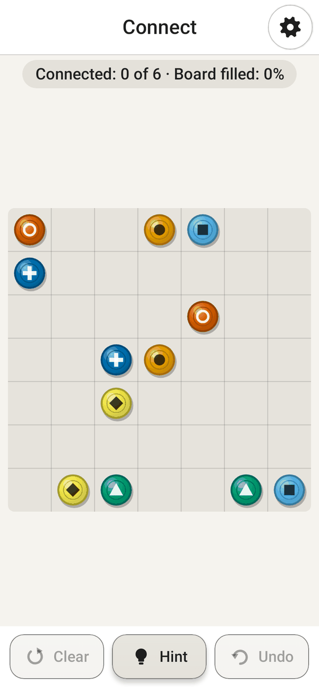

<div align="center">

# Mega Games

**Diez juegos clásicos en una aplicación Android pequeña y privada, pensada para personas mayores.**

Sudoku · Solitario · Buraco · Backgammon · Mahjong · Reversi · Crucigrama · Tuberías · Une los colores · Puntos

🌐 [English](README.md) · [Português](README.pt-BR.md) · **Español** · [Français](README.fr.md) · [中文](README.zh-CN.md)

[](https://github.com/fershibli/game-mega-app/actions/workflows/ci.yml)
[](https://github.com/fershibli/game-mega-app/releases)


  

</div>

> Esta aplicación se hizo para mi madre, a quien le encantan estos juegos. Es gratuita para todo el mundo, para siempre:
> sin anuncios, sin cuentas, sin compras, sin internet y sin recogida de datos.

## Contenido

1. [Lo más destacado](#lo-más-destacado)
2. [Los juegos](#los-juegos)
3. [Pensada para personas mayores](#pensada-para-personas-mayores)
4. [Instalación](#instalación)
5. [Por qué puedes confiar en ella](#por-qué-puedes-confiar-en-ella)
6. [Capturas](#capturas)
7. [Documentación](#documentación)
8. [Compilar desde el código](#compilar-desde-el-código)
9. [Hecha con ayuda de IA](#hecha-con-ayuda-de-ia)
10. [Licencia](#licencia)

## Lo más destacado

- **10 juegos**, cada uno con **Fácil / Medio / Difícil**.
- **Los retos se generan al momento** (Sudoku, Mahjong, Tuberías, Une los colores, Crucigrama…), así que nunca se repiten, y todos **tienen solución garantizada**.
- **Rivales de verdad**: el ordenador juega con estrategias escritas especialmente para Backgammon, Buraco y Reversi.
- **Zoom con dos dedos en todos los juegos**, y zoom con un dedo en el modo una mano.
- **Guardado automático**: si la aplicación se cierra sin querer, ofrece seguir justo donde lo dejaste.
- **5 idiomas**: inglés, portugués de Brasil, español, francés y chino simplificado, tanto la interfaz *como* los diccionarios del crucigrama.
- **Pequeña y ligera**: unos **1,3 MB**, Kotlin nativo + Jetpack Compose, sin motor de juego y sin imágenes: todo el arte se dibuja con código.

## Los juegos

| | Juego | Qué es | Cómo cambia la dificultad |
|---|---|---|---|
|  | **Sudoku** | El clásico 9×9 con notas, pistas y deshacer | 40 → 32 → 26 números iniciales; errores en rojo en Fácil y Medio |
|  | **Solitario** | Klondike; toca una carta y va al mejor sitio | Robar 1 → robar 3 → robar 3 con solo 3 vueltas al mazo |
|  | **Buraco** | Rummy brasileño contra el ordenador (dos barajas, los 2 son comodines, muertos, canastas) | Ordenador más listo: toma el pozo con criterio, guarda sus comodines, evita darte cartas |
|  | **Backgammon** | Reglas completas (barra, capturas, sacar fichas, gammon) | Desde un ordenador "despistado" hasta uno que mira una tirada por delante (expectimax) |
|  | **Mahjong** | Mahjong solitario con fichas en 3D; las fichas bloqueadas se oscurecen | 48 → 96 → 144 fichas (la tortuga clásica) |
|  | **Reversi** | Othello contra el ordenador; se muestran las jugadas posibles | Búsqueda alfa-beta de profundidad 1 → 3 → 6 (final perfecto) |
|  | **Crucigrama** | Un crucigrama nuevo cada vez, en tu idioma | Banco de letras → teclado completo; sin marcar errores en Difícil |
|  | **Tuberías** | Gira las piezas hasta que el agua llegue a todas | 5×5 → 7×7 → 9×9 |
|  | **Une los colores** | Une los puntos del mismo color sin cruzar líneas | 5×5/4 colores → 7×7/6 → 9×9/8; en Medio y Difícil hay que llenar el tablero |
|  | **Puntos** | Une puntos del mismo color; cierra un cuadrado para limpiar un color | Tablero más grande, más colores, menos movimientos |

Reglas completas y consejos: **[Guía de uso](docs/es/user-guide.md)**.

## Pensada para personas mayores

- **Navegación muy sencilla**: elige el juego (solo imágenes, no hace falta leer) → elige la dificultad en una rueda → juega. El engranaje (⚙) siempre está en la misma esquina.
- **Botones al alcance del pulgar**: casi todos los botones de acción están en la mitad inferior de la pantalla. El **modo zurdo** los refleja.
- **Modo una mano**: el engranaje se convierte en una burbuja flotante que se esconde en el borde; el zoom funciona con **doble toque** o **mantener y girar**.
- **Tamaño de texto y de piezas/botones ajustable** (del 80 % al 160 %).
- **Tres modos de color, cada uno con su modo oscuro**: Normal (contraste medio), Alto contraste (bordes gruesos) y Para daltonismo (paleta Okabe–Ito, formas dibujadas en las piezas de color, baraja de cuatro colores).
- Zonas táctiles grandes (56 dp), letra grande, pistas y deshacer ilimitado, y ningún cronómetro.

Más: **[Sección de accesibilidad de la guía](docs/es/user-guide.md#accesibilidad)**.

## Instalación

1. En el teléfono Android, abre **[Releases](https://github.com/fershibli/game-mega-app/releases)** y descarga el `MegaGames-vX.Y.Z.apk` más reciente.
2. Abre el archivo. Si Android lo pide, permite que el navegador o el gestor de archivos "instale aplicaciones desconocidas".
3. Opcional: compara el SHA-256 del archivo con el `SHA256SUMS.txt` de la misma versión.

Necesita Android 6.0 o posterior. Paso a paso: [Guía → Instalación](docs/es/user-guide.md#instalación).

## Por qué puedes confiar en ella

| Afirmación | Cómo comprobarlo tú mismo |
|---|---|
| Sin internet ni rastreo | El manifiesto **no declara ningún permiso** ([AndroidManifest.xml](app/src/main/AndroidManifest.xml)); sin `INTERNET`, Android bloquea cualquier conexión. |
| Sin código oculto | 100 % código abierto; solo bibliotecas oficiales AndroidX/Kotlin ([libs.versions.toml](gradle/libs.versions.toml)). Ningún SDK de publicidad ni de analítica. |
| Lo que compila el CI es lo que instalas | Cada push se compila, se prueba y se analiza en GitHub Actions; los APK se publican con sumas SHA-256. El bloque de "información de dependencias" de Google está desactivado, así que todo el contenido del APK se puede inspeccionar. |
| Funciona | 50 pruebas automáticas en cada compilación: reglas, generadores (todo reto tiene solución), IA, traducciones, guardado automático y el flujo de la interfaz (zoom, una mano, navegación). Lint trata las advertencias como errores. |
| Herramientas de compilación seguras | El checksum del Gradle wrapper está fijado y se valida en el CI; Dependabot mantiene las dependencias al día. |

Detalles: **[Confianza, privacidad y seguridad](docs/es/trust.md)** · [SECURITY.md](SECURITY.md)

## Capturas

| Inicio (oscuro) | Alto contraste | Daltonismo + oscuro | Modo una mano |
|---|---|---|---|
|  |  |  |  |

| Dificultad | Ajustes | ¿Continuar? | Conectar (daltonismo) |
|---|---|---|---|
|  |  |  |  |

Todas las capturas se generan automáticamente desde el código real (ver [Compilar](docs/es/building.md#capturas)).

## Documentación

| Idioma | Guía de uso | Confianza y privacidad | Diseño técnico | Compilar y contribuir |
|---|---|---|---|---|
| English | [user-guide](docs/en/user-guide.md) | [trust](docs/en/trust.md) | [technical](docs/en/technical.md) | [building](docs/en/building.md) |
| Português | [guia](docs/pt-BR/user-guide.md) | [confiança](docs/pt-BR/trust.md) | [técnico](docs/pt-BR/technical.md) | [compilar](docs/pt-BR/building.md) |
| Español | [guía](docs/es/user-guide.md) | [confianza](docs/es/trust.md) | [técnico](docs/es/technical.md) | [compilar](docs/es/building.md) |
| Français | [guide](docs/fr/user-guide.md) | [confiance](docs/fr/trust.md) | [technique](docs/fr/technical.md) | [compiler](docs/fr/building.md) |
| 中文 | [用户指南](docs/zh-CN/user-guide.md) | [信任与隐私](docs/zh-CN/trust.md) | [技术设计](docs/zh-CN/technical.md) | [构建与贡献](docs/zh-CN/building.md) |

Índice completo: [docs/README.md](docs/README.md).

## Compilar desde el código

```bash
git clone https://github.com/fershibli/game-mega-app.git
cd game-mega-app
./gradlew testDebugUnitTest lintDebug assembleDebug
# APK: app/build/outputs/apk/debug/app-debug.apk
```

Necesita JDK 17+ y el Android SDK (API 37). Ver [docs/es/building.md](docs/es/building.md).

## Hecha con ayuda de IA

Todo lo que hay en este repositorio —el código, el arte (cada carta, ficha, tablero e icono está dibujado con código) y esta documentación en cinco idiomas— se creó con la ayuda de **Claude**, el asistente de IA de **Anthropic**, bajo la dirección del responsable del proyecto. Las decisiones de diseño se explican en [docs/es/technical.md](docs/es/technical.md), y las pruebas existen para que nadie tenga que fiarse del código a ciegas.

## Licencia

[MIT](LICENSE): libre para usar, copiar, modificar y compartir.
