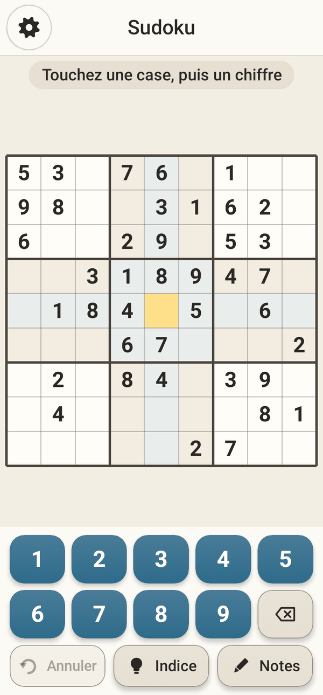

<div align="center">

# Mili Games

**Dix jeux classiques dans une petite application Android respectueuse de la vie privée, pensée pour les personnes âgées.**

Sudoku · Solitaire · Buraco · Backgammon · Mahjong · Reversi · Mots croisés · Tuyaux · Relie les couleurs · Points

🌐 [English](README.md) · [Português](README.pt-BR.md) · [Español](README.es.md) · **Français** · [中文](README.zh-CN.md)

[](https://github.com/fershibli/game-mega-app/actions/workflows/ci.yml)
[](https://github.com/fershibli/game-mega-app/releases)


  

</div>

> Cette application a été faite pour ma mère, qui adore ces jeux. Elle est gratuite pour tout le monde, pour toujours :
> pas de publicité, pas de compte, pas d’achat, pas d’accès à Internet, aucune collecte de données.

## Sommaire

1. [Points forts](#points-forts)
2. [Les jeux](#les-jeux)
3. [Pensée pour les personnes âgées](#pensée-pour-les-personnes-âgées)
4. [Installation](#installation)
5. [Pourquoi vous pouvez lui faire confiance](#pourquoi-vous-pouvez-lui-faire-confiance)
6. [Captures d’écran](#captures-décran)
7. [Documentation](#documentation)
8. [Compiler depuis les sources](#compiler-depuis-les-sources)
9. [Réalisée avec l’aide d’une IA](#réalisée-avec-laide-dune-ia)
10. [Licence](#licence)

## Points forts

- **10 jeux**, chacun en **Facile / Moyen / Difficile**.
- **Les grilles sont générées à la volée** (Sudoku, Mahjong, Tuyaux, Relie les couleurs, Mots croisés…) : elles ne se répètent jamais, et chacune **a une solution garantie**.
- **De vrais adversaires** : l’ordinateur joue avec des stratégies écrites spécialement pour le Backgammon, le Buraco et le Reversi.
- **Zoom à deux doigts dans tous les jeux**, et zoom à un doigt en mode une main.
- **Sauvegarde automatique** : si l’application se ferme par accident, elle propose de reprendre exactement là où vous en étiez.
- **5 langues** : anglais, portugais du Brésil, espagnol, français et chinois simplifié — l’interface *et* les dictionnaires des mots croisés.
- **Petite et légère** : environ **1,3 Mo**, Kotlin natif + Jetpack Compose, sans moteur de jeu ni images — tous les dessins sont réalisés par le code.

## Les jeux

| | Jeu | Ce que c’est | Ce qui change avec la difficulté |
|---|---|---|---|
|  | **Sudoku** | Le classique 9×9 avec notes, indices et annulation | 40 → 32 → 26 chiffres de départ ; erreurs en rouge en Facile et Moyen |
|  | **Solitaire** | Klondike ; touchez une carte et elle va au meilleur endroit | Tirer 1 → tirer 3 → tirer 3 avec seulement 3 tours de talon |
|  | **Buraco** | Rami brésilien contre l’ordinateur (deux jeux, les 2 sont des jokers, morts, canastas) | Ordinateur plus malin : prend la défausse à bon escient, garde ses jokers, évite de vous aider |
|  | **Backgammon** | Règles complètes (barre, prises, sortie des pions, gammon) | D’un ordinateur « distrait » à un ordinateur qui anticipe un lancer (expectimax) |
|  | **Mahjong** | Mahjong solitaire avec tuiles en relief ; les tuiles bloquées sont assombries | 48 → 96 → 144 tuiles (la tortue classique) |
|  | **Reversi** | Othello contre l’ordinateur ; les coups possibles sont indiqués | Recherche alpha-bêta de profondeur 1 → 3 → 6 (fin de partie parfaite) |
|  | **Mots croisés** | Une nouvelle grille à chaque fois, dans votre langue | Réserve de lettres → clavier complet (AZERTY) ; erreurs non signalées en Difficile |
|  | **Tuyaux** | Tournez les tuyaux jusqu’à ce que l’eau arrive partout | 5×5 → 7×7 → 9×9 |
|  | **Relie les couleurs** | Reliez les points de même couleur sans croiser les lignes | 5×5/4 couleurs → 7×7/6 → 9×9/8 ; en Moyen et Difficile il faut remplir le plateau |
|  | **Points** | Reliez des points de même couleur ; fermez un carré pour effacer une couleur | Plateau plus grand, plus de couleurs, moins de coups |

Règles complètes et astuces : **[Guide d’utilisation](docs/fr/user-guide.md)**.

## Pensée pour les personnes âgées

- **Navigation très simple** : choisissez le jeu (images seulement, pas besoin de lire) → choisissez la difficulté sur une roue → jouez. La roue dentée (⚙) est toujours dans le même coin.
- **Boutons à portée de pouce** : presque tous les boutons d’action sont dans la moitié basse de l’écran. Le **mode gaucher** les inverse.
- **Mode une main** : la roue dentée devient une bulle flottante qui se cache dans le bord de l’écran ; le zoom fonctionne par **double toucher** ou **appuyer et tourner**.
- **Taille du texte et des pièces/boutons réglable** (de 80 % à 160 %).
- **Trois modes de couleur, chacun avec son mode sombre** : Normal (contraste moyen), Contraste élevé (contours épais) et Adapté au daltonisme (palette Okabe–Ito, formes dessinées sur les pièces colorées, jeu de cartes à quatre couleurs).
- Grandes zones tactiles (56 dp), gros caractères, indices et annulation illimitée, aucun chronomètre.

En savoir plus : **[Section accessibilité du guide](docs/fr/user-guide.md#accessibilité)**.

## Installation

1. Sur le téléphone Android, ouvrez **[Releases](https://github.com/fershibli/game-mega-app/releases)** et téléchargez le dernier `MiliGames-vX.Y.Z.apk`.
2. Ouvrez le fichier. Si Android le demande, autorisez le navigateur ou le gestionnaire de fichiers à « installer des applications inconnues ».
3. Facultatif : comparez le SHA-256 du fichier avec le `SHA256SUMS.txt` de la même version.

Nécessite Android 6.0 ou plus récent. Pas à pas : [Guide → Installation](docs/fr/user-guide.md#installation).

## Pourquoi vous pouvez lui faire confiance

| Affirmation | Comment le vérifier vous-même |
|---|---|
| Pas d’Internet, pas de pistage | Le manifeste **ne déclare aucune autorisation** ([AndroidManifest.xml](app/src/main/AndroidManifest.xml)) ; sans `INTERNET`, Android bloque toute connexion. |
| Pas de code caché | 100 % open source ; uniquement des bibliothèques officielles AndroidX/Kotlin ([libs.versions.toml](gradle/libs.versions.toml)). Aucun SDK de publicité ou de statistiques. |
| Ce que la CI compile est ce que vous installez | Chaque push est compilé, testé et analysé sur GitHub Actions ; les APK sont publiés avec leurs sommes SHA-256. Le bloc « informations de dépendances » de Google est désactivé : tout le contenu de l’APK est inspectable. |
| Ça fonctionne | 50 tests automatiques à chaque compilation : règles, générateurs (chaque grille a une solution), IA, traductions, sauvegarde automatique et parcours de l’interface (zoom, mode une main, navigation). Lint traite les avertissements comme des erreurs. |
| Outils de compilation sûrs | La somme de contrôle du Gradle wrapper est figée et vérifiée en CI ; Dependabot maintient les dépendances à jour. |

Détails : **[Confiance, vie privée et sécurité](docs/fr/trust.md)** · [SECURITY.md](SECURITY.md)

## Captures d’écran

| Accueil (sombre) | Contraste élevé | Daltonisme + sombre | Mode une main |
|---|---|---|---|
|  |  |  |  |

| Difficulté | Réglages | Continuer ? | Sudoku (français, gaucher) |
|---|---|---|---|
|  |  |  |  |

Toutes les captures sont générées automatiquement à partir du vrai code (voir [Compiler](docs/fr/building.md#captures-décran)).

## Documentation

| Langue | Guide d’utilisation | Confiance et vie privée | Conception technique | Compiler et contribuer |
|---|---|---|---|---|
| English | [user-guide](docs/en/user-guide.md) | [trust](docs/en/trust.md) | [technical](docs/en/technical.md) | [building](docs/en/building.md) |
| Português | [guia](docs/pt-BR/user-guide.md) | [confiança](docs/pt-BR/trust.md) | [técnico](docs/pt-BR/technical.md) | [compilar](docs/pt-BR/building.md) |
| Español | [guía](docs/es/user-guide.md) | [confianza](docs/es/trust.md) | [técnico](docs/es/technical.md) | [compilar](docs/es/building.md) |
| Français | [guide](docs/fr/user-guide.md) | [confiance](docs/fr/trust.md) | [technique](docs/fr/technical.md) | [compiler](docs/fr/building.md) |
| 中文 | [用户指南](docs/zh-CN/user-guide.md) | [信任与隐私](docs/zh-CN/trust.md) | [技术设计](docs/zh-CN/technical.md) | [构建与贡献](docs/zh-CN/building.md) |

Index complet : [docs/README.md](docs/README.md).

## Compiler depuis les sources

```bash
git clone https://github.com/fershibli/game-mega-app.git
cd game-mega-app
./gradlew testDebugUnitTest lintDebug assembleDebug
# APK : app/build/outputs/apk/debug/app-debug.apk
```

Nécessite le JDK 17+ et le SDK Android (API 37). Voir [docs/fr/building.md](docs/fr/building.md).

## Réalisée avec l’aide d’une IA

Tout ce que contient ce dépôt — le code, les illustrations (chaque carte, tuile, plateau et icône est dessiné par le code) et cette documentation en cinq langues — a été créé avec l’aide de **Claude**, l’assistant d’IA d’**Anthropic**, sous la direction du mainteneur. Les choix de conception sont expliqués dans [docs/fr/technical.md](docs/fr/technical.md), et les tests existent pour que personne n’ait à croire le code sur parole.

## Licence

[MIT](LICENSE) — libre d’utiliser, copier, modifier et partager.
