<div align="center">

# Mili Games

**Dieci giochi classici in una piccola app Android che rispetta la tua privacy, pensata per le persone anziane.**

Sudoku · Solitario · Buraco · Backgammon · Mahjong · Reversi · Cruciverba · Tubi · Unisci i colori · Puntini

🌐 [English](README.md) · [Português](README.pt-BR.md) · [Español](README.es.md) · [Français](README.fr.md) · **Italiano** · [Deutsch](README.de.md) · [Русский](README.ru.md) · [日本語](README.ja.md) · [中文](README.zh-CN.md) · [العربية](README.ar.md)

[](https://github.com/fershibli/game-mega-app/actions/workflows/ci.yml)
[](https://github.com/fershibli/game-mega-app/releases)


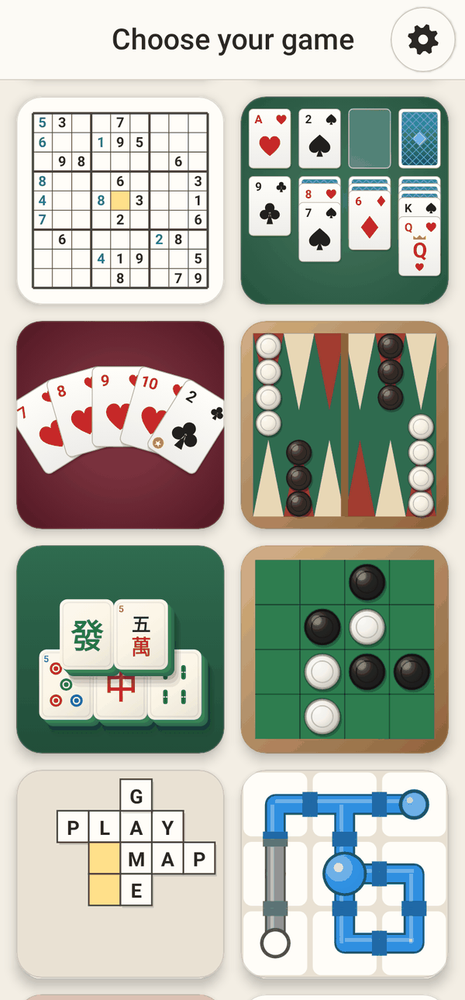 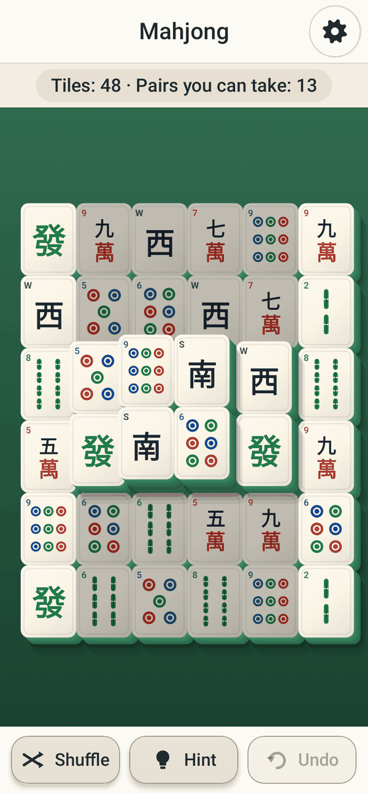 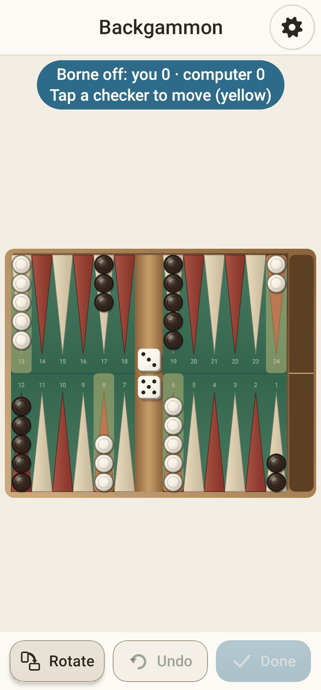

</div>

> Ho creato questa app per mia madre, che adora questi giochi. È gratuita per tutti, per sempre:
> niente pubblicità, niente account, niente acquisti nell’app, nessun accesso a internet, nessun dato raccolto.

## Indice

1. [In evidenza](#in-evidenza)
2. [I giochi](#i-giochi)
3. [Pensata per le persone anziane](#pensata-per-le-persone-anziane)
4. [Installazione](#installazione)
5. [Perché puoi fidarti](#perché-puoi-fidarti)
6. [Schermate](#schermate)
7. [Documentazione](#documentazione)
8. [Compilare dal codice sorgente](#compilare-dal-codice-sorgente)
9. [Realizzata con l’aiuto dell’IA](#realizzata-con-laiuto-dellia)
10. [Licenza](#licenza)

## In evidenza

- **10 giochi**, ognuno con i livelli **Facile / Medio / Difficile**.
- **I rompicapi vengono creati sul momento** (Sudoku, Mahjong, Tubi, Unisci i colori, Cruciverba…), quindi non si ripetono mai, e ognuno di essi **si può sempre risolvere**.
- **Veri avversari al computer**, scritti apposta per Backgammon, Buraco e Reversi.
- **Zoom con due dita in ogni gioco**, più lo zoom con un dito solo nella modalità una mano.
- **Salvataggio automatico**: se chiudi l’app per sbaglio, ti propone di riprendere esattamente da dove avevi lasciato.
- **10 lingue**: inglese, portoghese (Brasile), spagnolo, francese, italiano, tedesco, russo, giapponese, cinese semplificato e arabo. Sono tradotti sia l’app *sia* i dizionari dei cruciverba.
- **Piccola e leggera**: circa **1,3 MB**, scritta in Kotlin nativo con Jetpack Compose, senza motore di gioco e senza immagini: tutta la grafica è disegnata dal codice.

## I giochi

| | Gioco | Che cos’è | Come cambia la difficoltà |
|---|---|---|---|
| 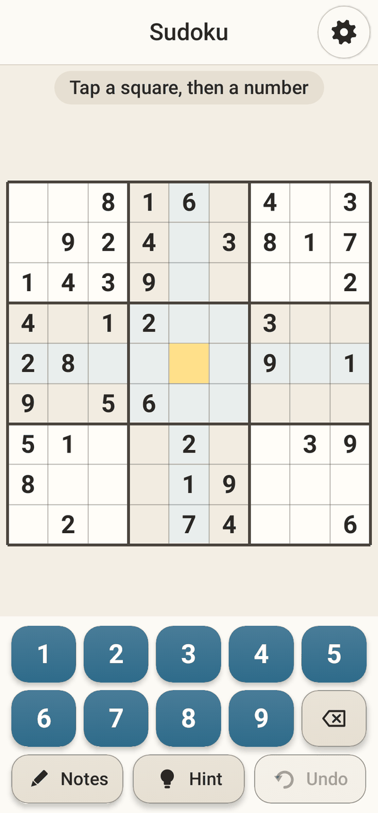 | **Sudoku** | Il classico rompicapo di numeri 9×9, con note, suggerimenti e annulla | 40 → 32 → 26 numeri di partenza; errori in rosso nei livelli Facile e Medio |
| 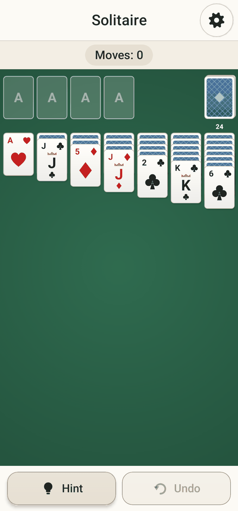 | **Solitario** | Klondike; tocca una carta e lei va nel posto migliore | Pesca 1 → pesca 3 → pesca 3 con solo 3 giri del mazzo |
| 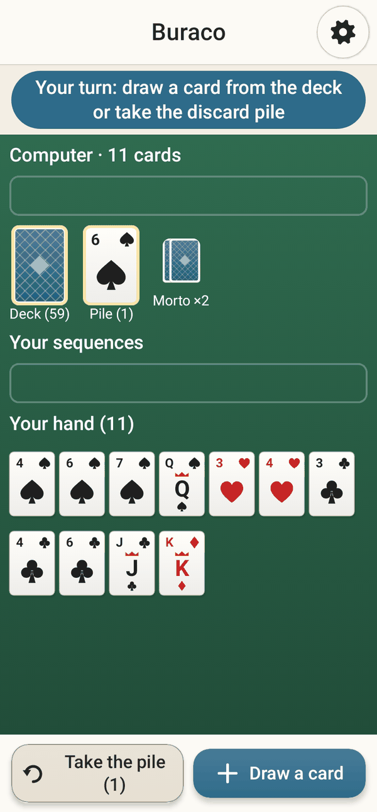 | **Buraco** | Il burraco brasiliano contro il computer (due mazzi, i 2 sono jolly, pozzetti, canaste) | Computer più furbo: prende gli scarti con giudizio, conserva i jolly, evita di passarti carte utili |
|  | **Backgammon** | Regole complete (barra, pedine colpite, uscita, gammon) | Da un computer “alla buona” fino a uno che prevede il lancio successivo (expectimax) |
|  | **Mahjong** | Mahjong solitario con tessere in 3D; le tessere bloccate appaiono più sbiadite | 48 → 96 → 144 tessere (la classica tartaruga) |
| 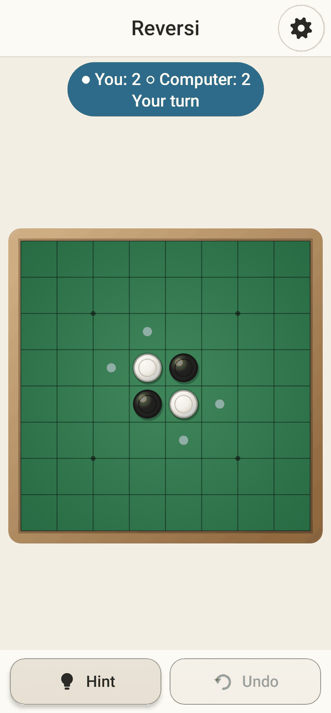 | **Reversi** | Othello contro il computer; le mosse possibili sono indicate | Ricerca alfa-beta a profondità 1 → 3 → 6 (finale perfetto) |
| 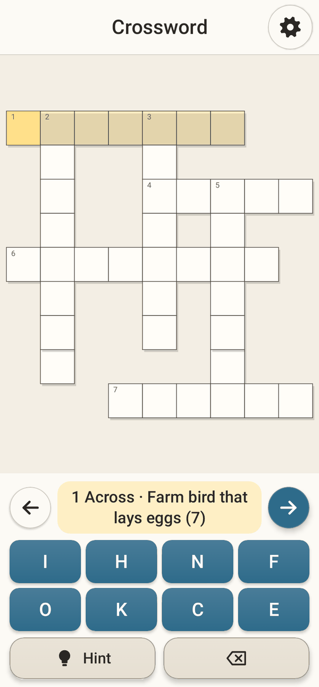 | **Cruciverba** | Un cruciverba nuovo ogni volta, nella tua lingua | Lettere suggerite → tastiera completa; errori non evidenziati nel livello Difficile |
| 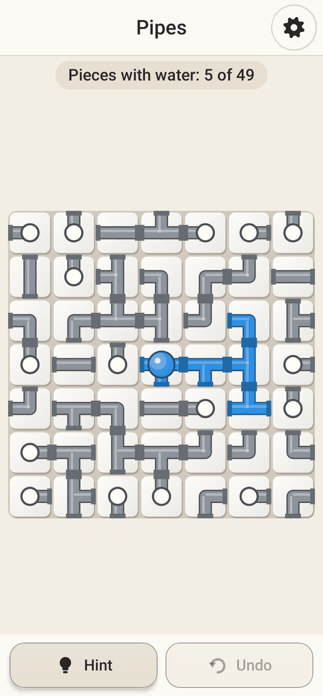 | **Tubi** | Gira i pezzi di tubo finché l’acqua arriva dappertutto | 5×5 → 7×7 → 9×9 |
| 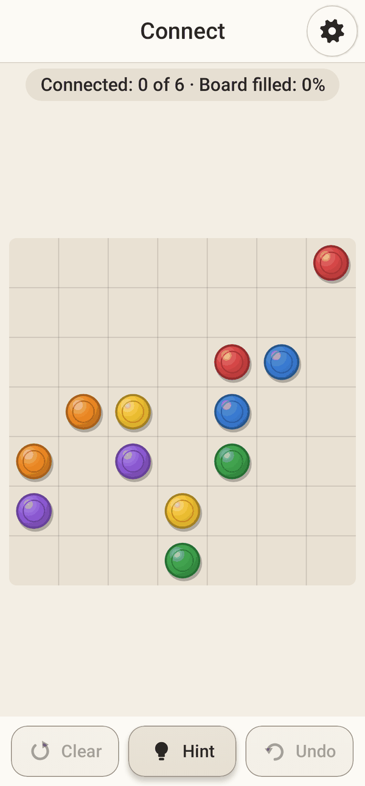 | **Unisci i colori** | Collega i puntini dello stesso colore senza incrociare le linee | 5×5/4 colori → 7×7/6 → 9×9/8; nei livelli Medio e Difficile bisogna riempire tutto il tabellone |
| 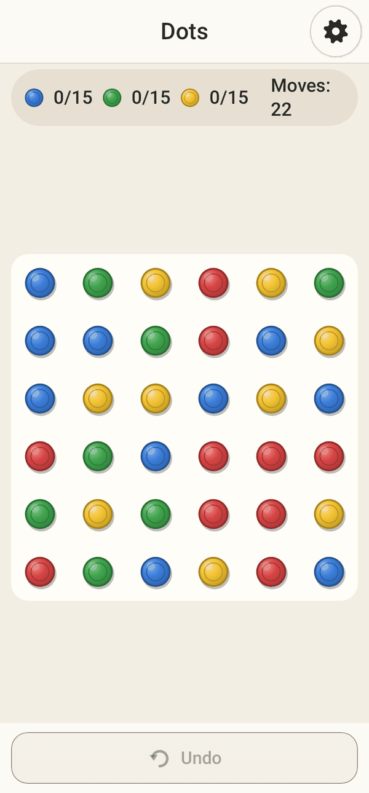 | **Puntini** | Unisci i puntini dello stesso colore; chiudi un quadrato per eliminare tutto un colore | Tabellone più grande, più colori, meno mosse |

Regole complete e consigli: **[Guida per l’utente](docs/it/user-guide.md)**.

## Pensata per le persone anziane

- **Navigazione semplicissima**: scegli un gioco (solo immagini, non serve leggere) → scegli la difficoltà su una rotella → gioca. L’ingranaggio (⚙) è sempre nello stesso angolo.
- **Pulsanti a portata di pollice**: quasi tutti i pulsanti si trovano nella metà bassa dello schermo. La **modalità mancini** li sposta sul lato opposto.
- **Modalità una mano**: l’ingranaggio diventa una bolla mobile che si nasconde a metà nel bordo dello schermo; lo zoom funziona con il **doppio tocco** oppure con **premi e gira**.
- **Dimensione del testo e di pezzi e pulsanti regolabile** (dall’80 % al 160 %).
- **Tre modalità di colore, ognuna con la sua versione scura**: Normale (contrasto medio), Alto contrasto (bordi spessi), Adatto ai daltonici (tavolozza Okabe–Ito, forme disegnate sui pezzi colorati, carte in quattro colori).
- Grandi zone da toccare (56 dp), caratteri grandi, suggerimenti e annullamento delle mosse senza limiti, e nessun timer da nessuna parte.

Per saperne di più: **[sezione Accessibilità della guida](docs/it/user-guide.md#accessibilità)**.

## Installazione

1. Sul telefono Android apri la pagina **[Releases](https://github.com/fershibli/game-mega-app/releases)** e scarica l’ultimo file `MiliGames-vX.Y.Z.apk`.
2. Apri il file. Se Android lo chiede, permetti al browser o all’app dei file di “installare app sconosciute”.
3. Facoltativo: confronta lo SHA-256 del file con `SHA256SUMS.txt` nella stessa release.

Serve Android 6.0 o più recente. Istruzioni passo passo con le immagini: [Guida → Installazione](docs/it/user-guide.md#installazione).

## Perché puoi fidarti

| Affermazione | Come verificarla da solo |
|---|---|
| Niente internet, nessun tracciamento | Il manifest non dichiara **nessuna autorizzazione** ([AndroidManifest.xml](app/src/main/AndroidManifest.xml)); senza `INTERNET` Android blocca ogni accesso alla rete. |
| Nessun codice nascosto | Codice sorgente aperto al 100 %; solo librerie ufficiali AndroidX/Kotlin ([libs.versions.toml](gradle/libs.versions.toml)). Nessun SDK di pubblicità o di statistiche. |
| Ricevi esattamente ciò che la CI compila | Ogni modifica viene compilata, testata e controllata con lint su GitHub Actions; gli APK vengono pubblicati con i checksum SHA-256. Il blocco “dependency info” di Google è disattivato, così il contenuto dell’APK si può ispezionare per intero. |
| Funziona | 50 test automatici a ogni compilazione: regole, generatori (ogni rompicapo è risolvibile), avversari al computer, traduzioni, salvataggio automatico e il percorso nell’interfaccia (zoom con due dita, zoom con una mano, navigazione). Lint tratta gli avvisi come errori. |
| Strumenti di compilazione sicuri | Il checksum del Gradle wrapper è fissato e verificato nella CI; Dependabot tiene aggiornate le dipendenze. |

Dettagli: **[Fiducia, privacy e sicurezza](docs/it/trust.md)** · [SECURITY.md](SECURITY.md)

## Schermate

| Inizio (scuro) | Alto contrasto | Daltonici + scuro | Modalità una mano |
|---|---|---|---|
| 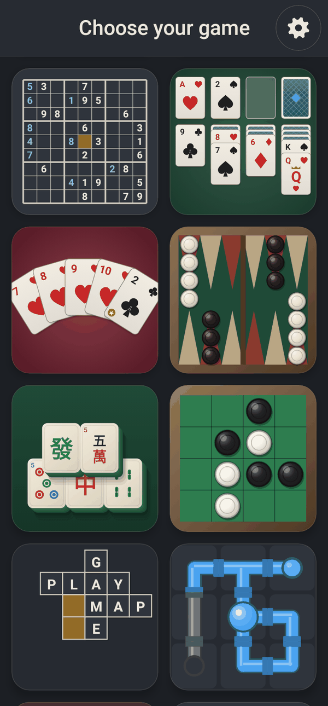 | 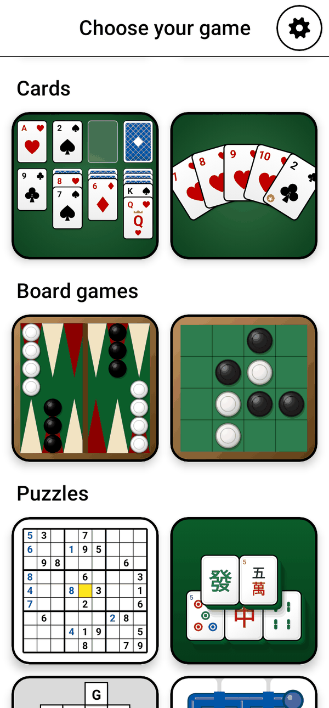 | 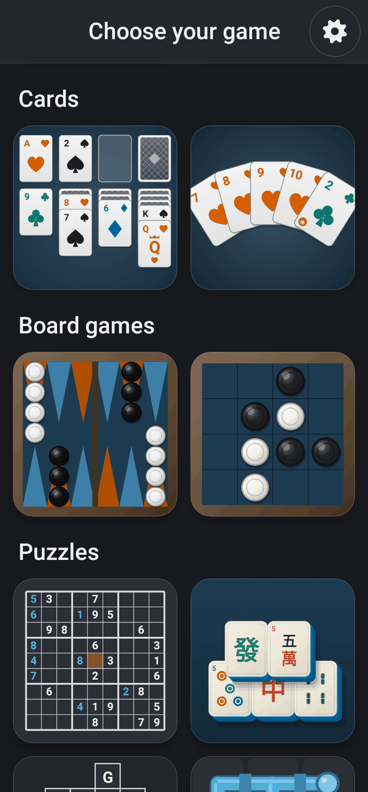 | 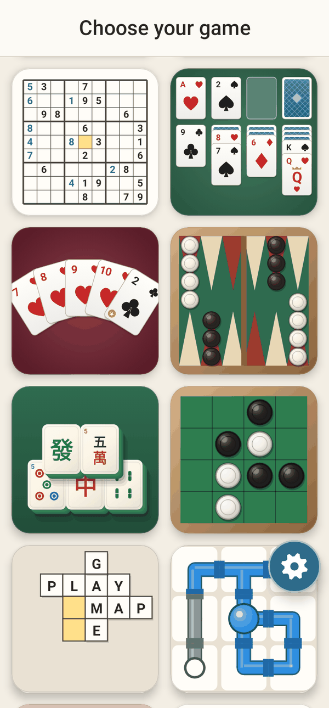 |

| Difficoltà | Impostazioni | Continuare? | Buraco (Português) |
|---|---|---|---|
| 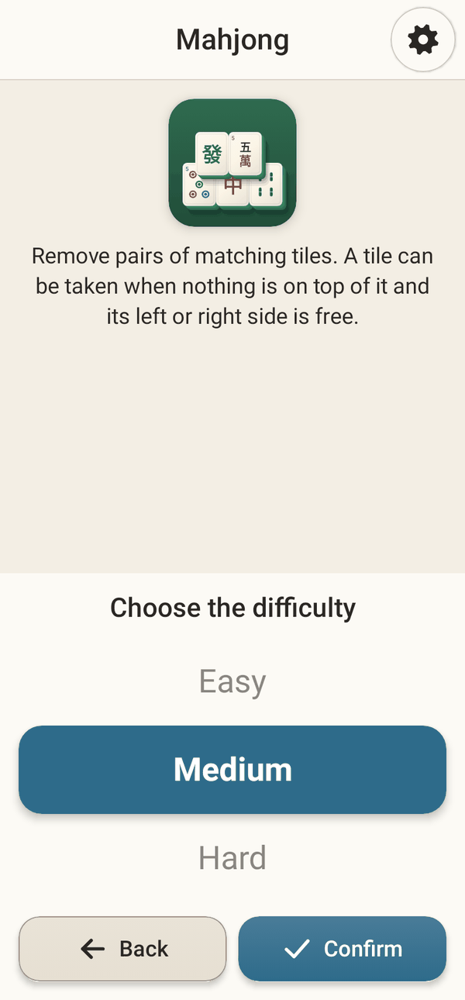 | 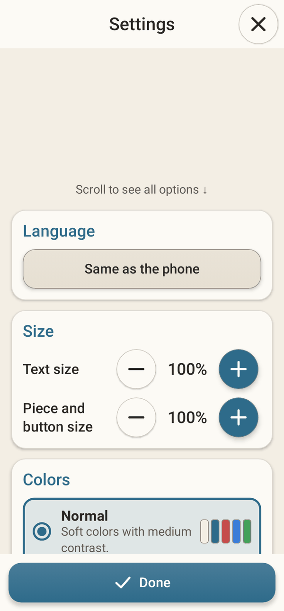 | 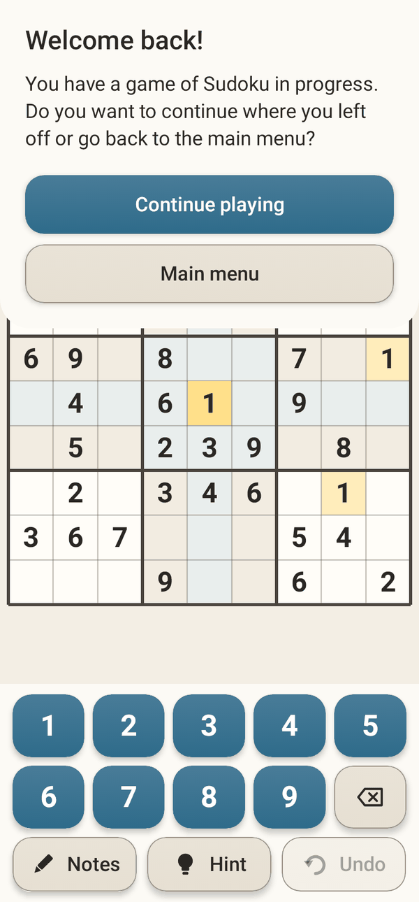 | 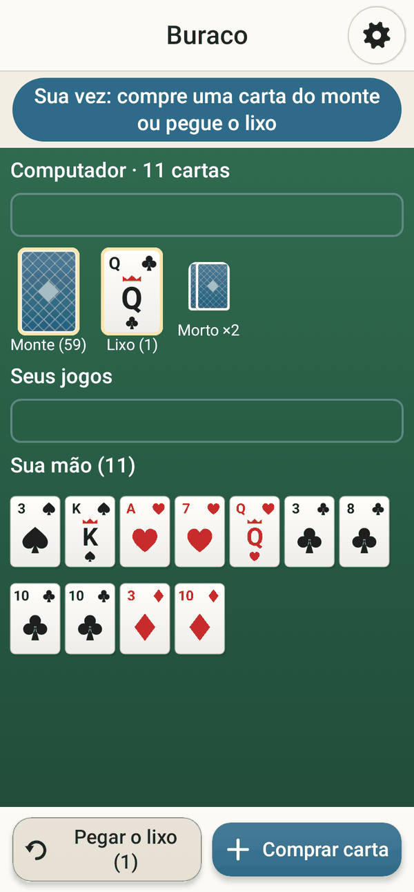 |

Tutte le schermate sono generate automaticamente dal codice reale (vedi [Building](docs/en/building.md#screenshots), in inglese).

## Documentazione

| Lingua | Guida per l’utente | Fiducia e privacy | Progettazione tecnica | Compilare e contribuire |
|---|---|---|---|---|
| English | [user-guide](docs/en/user-guide.md) | [trust](docs/en/trust.md) | [technical](docs/en/technical.md) | [building](docs/en/building.md) |
| Português | [guia](docs/pt-BR/user-guide.md) | [confiança](docs/pt-BR/trust.md) | [técnico](docs/pt-BR/technical.md) | [compilar](docs/pt-BR/building.md) |
| Español | [guía](docs/es/user-guide.md) | [confianza](docs/es/trust.md) | [técnico](docs/es/technical.md) | [compilar](docs/es/building.md) |
| Français | [guide](docs/fr/user-guide.md) | [confiance](docs/fr/trust.md) | [technique](docs/fr/technical.md) | [compiler](docs/fr/building.md) |
| Italiano | [guida](docs/it/user-guide.md) | [fiducia](docs/it/trust.md) | [technical (EN)](docs/en/technical.md) | [building (EN)](docs/en/building.md) |
| 中文 | [用户指南](docs/zh-CN/user-guide.md) | [信任与隐私](docs/zh-CN/trust.md) | [技术设计](docs/zh-CN/technical.md) | [构建与贡献](docs/zh-CN/building.md) |
| العربية | [دليل الاستخدام](docs/ar/user-guide.md) | [الثقة والخصوصية](docs/ar/trust.md) | [technical (EN)](docs/en/technical.md) | [building (EN)](docs/en/building.md) |

La pubblicazione su Google Play è descritta in [google-play.md](docs/en/google-play.md) (in inglese). Indice completo: [docs/README.md](docs/README.md).

## Compilare dal codice sorgente

```bash
git clone https://github.com/fershibli/game-mega-app.git
cd game-mega-app
./gradlew testDebugUnitTest lintDebug assembleDebug
# APK: app/build/outputs/apk/debug/app-debug.apk
```

Servono JDK 17 o più recente e l’Android SDK (API 37). Vedi [docs/en/building.md](docs/en/building.md) (in inglese).

## Realizzata con l’aiuto dell’IA

Tutto ciò che si trova in questo repository (il codice, la grafica, perché ogni carta, tessera, tabellone e icona è disegnata dal codice, e questa documentazione in più lingue) è stato creato con l’aiuto di **Claude**, l’assistente di intelligenza artificiale di **Anthropic**, sotto la guida del responsabile del progetto. Le scelte di progettazione sono spiegate in [docs/en/technical.md](docs/en/technical.md) (in inglese), e la serie di test esiste proprio perché nessuno debba fidarsi del codice sulla parola.

## Licenza

[MIT](LICENSE): puoi usarla, copiarla, modificarla e condividerla liberamente.
