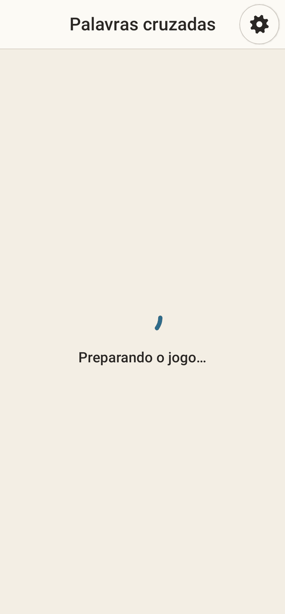
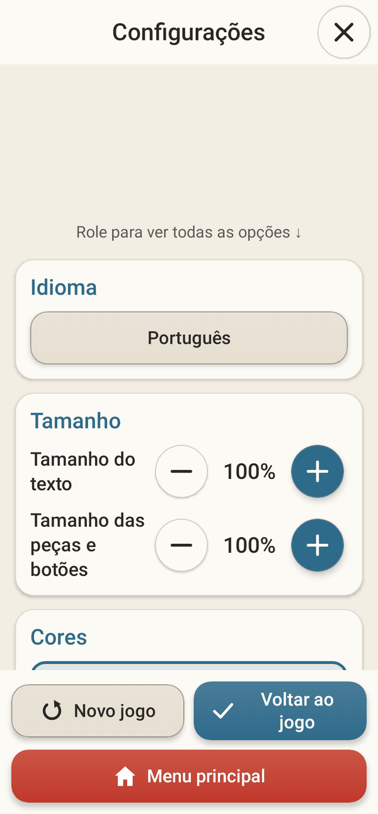

<div align="center">

# Mega Games

**Dez jogos clássicos num app Android pequeno e privado — pensado para pessoas idosas.**

Sudoku · Paciência · Buraco · Gamão · Mahjong · Reversi · Palavras cruzadas · Encanamento · Ligue as cores · Pontinhos

🌐 [English](README.md) · **Português** · [Español](README.es.md) · [Français](README.fr.md) · [中文](README.zh-CN.md)

[](https://github.com/fershibli/game-mega-app/actions/workflows/ci.yml)
[](https://github.com/fershibli/game-mega-app/releases)


  

</div>

> Este app foi feito para a minha mãe, que adora esses jogos. Ele é gratuito para todo mundo, para sempre:
> sem anúncios, sem cadastro, sem compras, sem internet e sem coleta de dados.

## Sumário

1. [Destaques](#destaques)
2. [Os jogos](#os-jogos)
3. [Feito para pessoas idosas](#feito-para-pessoas-idosas)
4. [Instalação](#instalação)
5. [Por que você pode confiar](#por-que-você-pode-confiar)
6. [Telas](#telas)
7. [Documentação](#documentação)
8. [Compilar a partir do código](#compilar-a-partir-do-código)
9. [Feito com ajuda de IA](#feito-com-ajuda-de-ia)
10. [Licença](#licença)

## Destaques

- **10 jogos**, cada um com **Fácil / Médio / Difícil**.
- **Os desafios são gerados na hora** (Sudoku, Mahjong, Encanamento, Ligue as cores, Palavras cruzadas…), então nunca se repetem — e todo desafio gerado **tem solução garantida**.
- **Adversários de verdade no computador**, escritos especialmente para Gamão, Buraco e Reversi.
- **Zoom com pinça em todos os jogos**, e zoom com um dedo no modo uma mão.
- **Salvamento automático**: se o app fechar sem querer, ele oferece continuar exatamente de onde parou.
- **5 idiomas**: inglês, português do Brasil, espanhol, francês e chinês simplificado — a interface *e* os dicionários das palavras cruzadas.
- **Pequeno e leve**: cerca de **1,3 MB**, Kotlin nativo + Jetpack Compose, sem motor de jogo e sem imagens — toda a arte é desenhada em código.

## Os jogos

| | Jogo | O que é | Como a dificuldade muda |
|---|---|---|---|
|  | **Sudoku** | O clássico 9×9 com notas, dicas e desfazer | 40 → 32 → 26 números iniciais; erros em vermelho no Fácil e no Médio |
|  | **Paciência** | Klondike; toque na carta e ela vai para o melhor lugar | Vira 1 → vira 3 → vira 3 com só 3 voltas no monte |
|  | **Buraco** | Buraco brasileiro contra o computador (dois baralhos, 2 é curinga, morto, canastras) | Computador mais esperto: pega o lixo na hora certa, guarda curingas, evita te dar cartas |
|  | **Gamão** | Regras completas (barra, captura, retirada, gamão) | Do computador "distraído" a um que prevê a próxima jogada de dados (expectimax) |
|  | **Mahjong** | Mahjong paciência com peças em 3D; as peças presas ficam escurecidas | 48 → 96 → 144 peças (a tartaruga clássica) |
|  | **Reversi** | Othello contra o computador; as jogadas possíveis aparecem | Busca alfa-beta de profundidade 1 → 3 → 6 (final perfeito) |
|  | **Palavras cruzadas** | Uma cruzadinha nova a cada vez, no seu idioma | Banco de letras → teclado completo; sem marcar erros no Difícil |
|  | **Encanamento** | Gire os canos até a água chegar em todos | 5×5 → 7×7 → 9×9 |
|  | **Ligue as cores** | Ligue bolinhas da mesma cor sem cruzar as linhas | 5×5/4 cores → 7×7/6 → 9×9/8; no Médio e no Difícil precisa preencher tudo |
|  | **Pontinhos** | Ligue bolinhas da mesma cor; feche um quadrado para limpar uma cor | Tabuleiro maior, mais cores, menos jogadas |

Regras completas e dicas: **[Guia do usuário](docs/pt-BR/user-guide.md)**.

## Feito para pessoas idosas

- **Navegação bem simples**: escolha o jogo (só imagem, sem precisar ler) → escolha a dificuldade numa roleta → jogue. A engrenagem (⚙) fica sempre no mesmo canto.
- **Botões onde o polegar alcança**: quase todos os botões de ação ficam na metade de baixo da tela. O **modo canhoto** espelha tudo.
- **Modo uma mão**: a engrenagem vira uma bolinha flutuante que se recolhe na borda da tela; o zoom funciona com **toque duplo** ou **pressionar e girar**.
- **Tamanho do texto e das peças/botões ajustável** (80 % a 160 %).
- **Três modos de cor, cada um com seu modo escuro**: Normal (contraste médio), Alto contraste (contornos grossos) e Para daltônicos (paleta Okabe–Ito, formas desenhadas nas peças coloridas, baralho de quatro cores).
- Áreas de toque grandes (56 dp), letras grandes, dicas e desfazer ilimitado, e nenhum cronômetro.

Mais: **[Seção de acessibilidade do guia](docs/pt-BR/user-guide.md#acessibilidade)**.

## Instalação

1. No celular Android, abra **[Releases](https://github.com/fershibli/game-mega-app/releases)** e baixe o `MegaGames-vX.Y.Z.apk` mais recente.
2. Abra o arquivo. Se o Android pedir, permita que o navegador/gerenciador de arquivos "instale apps desconhecidos".
3. Opcional: compare o SHA-256 do arquivo com o `SHA256SUMS.txt` da mesma versão.

Precisa de Android 6.0 ou mais novo. Passo a passo detalhado: [Guia → Instalação](docs/pt-BR/user-guide.md#instalação).

## Por que você pode confiar

| Afirmação | Como você mesmo pode conferir |
|---|---|
| Sem internet, sem rastreamento | O manifesto **não declara nenhuma permissão** ([AndroidManifest.xml](app/src/main/AndroidManifest.xml)); sem `INTERNET`, o Android bloqueia qualquer conexão. |
| Sem código escondido | 100 % código aberto; só bibliotecas oficiais AndroidX/Kotlin ([libs.versions.toml](gradle/libs.versions.toml)). Nenhum SDK de anúncios ou estatísticas. |
| O que o CI compila é o que você instala | Todo push é compilado, testado e analisado no GitHub Actions; os APKs saem com somas SHA-256. O bloco de "informações de dependências" do Google está desativado, então todo o conteúdo do APK pode ser inspecionado. |
| Funciona | 50 testes automáticos em toda compilação: regras, geradores (todo desafio tem solução), IA, traduções, salvamento automático e o fluxo da interface (pinça, zoom de uma mão, navegação). O lint roda tratando avisos como erros. |
| Ferramentas de build seguras | O checksum do Gradle wrapper é fixado e validado no CI; o Dependabot mantém as dependências em dia. |

Detalhes: **[Confiança, privacidade e segurança](docs/pt-BR/trust.md)** · [SECURITY.md](SECURITY.md)

## Telas

| Início (escuro) | Alto contraste | Daltonismo + escuro | Modo uma mão |
|---|---|---|---|
|  |  |  |  |

| Dificuldade | Configurações (no jogo) | Continuar? | Buraco |
|---|---|---|---|
|  |  |  |  |

Todas as imagens são geradas automaticamente a partir do código real (veja [Compilar](docs/pt-BR/building.md#capturas-de-tela)).

## Documentação

| Idioma | Guia do usuário | Confiança e privacidade | Design técnico | Compilar e contribuir |
|---|---|---|---|---|
| English | [user-guide](docs/en/user-guide.md) | [trust](docs/en/trust.md) | [technical](docs/en/technical.md) | [building](docs/en/building.md) |
| Português | [guia](docs/pt-BR/user-guide.md) | [confiança](docs/pt-BR/trust.md) | [técnico](docs/pt-BR/technical.md) | [compilar](docs/pt-BR/building.md) |
| Español | [guía](docs/es/user-guide.md) | [confianza](docs/es/trust.md) | [técnico](docs/es/technical.md) | [compilar](docs/es/building.md) |
| Français | [guide](docs/fr/user-guide.md) | [confiance](docs/fr/trust.md) | [technique](docs/fr/technical.md) | [compiler](docs/fr/building.md) |
| 中文 | [用户指南](docs/zh-CN/user-guide.md) | [信任与隐私](docs/zh-CN/trust.md) | [技术设计](docs/zh-CN/technical.md) | [构建与贡献](docs/zh-CN/building.md) |

Índice completo: [docs/README.md](docs/README.md).

## Compilar a partir do código

```bash
git clone https://github.com/fershibli/game-mega-app.git
cd game-mega-app
./gradlew testDebugUnitTest lintDebug assembleDebug
# APK: app/build/outputs/apk/debug/app-debug.apk
```

Precisa de JDK 17+ e do Android SDK (API 37). Veja [docs/pt-BR/building.md](docs/pt-BR/building.md).

## Feito com ajuda de IA

Tudo neste repositório — o código, a arte (cada carta, peça, tabuleiro e ícone é desenhado em código) e esta documentação em cinco idiomas — foi criado com a ajuda do **Claude**, o assistente de IA da **Anthropic**, sob a direção do mantenedor. As decisões de projeto estão explicadas em [docs/pt-BR/technical.md](docs/pt-BR/technical.md), e a bateria de testes existe justamente para que ninguém precise confiar no código "de olhos fechados".

## Licença

[MIT](LICENSE) — livre para usar, copiar, modificar e compartilhar.
