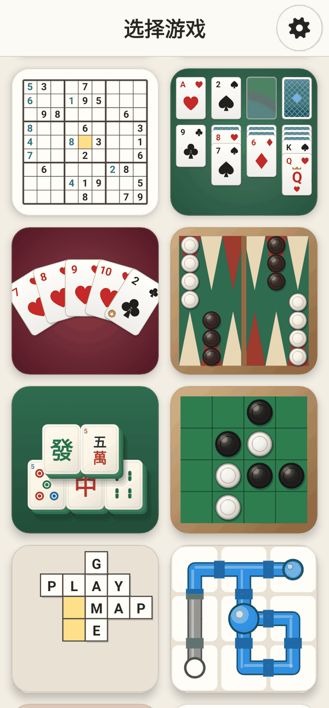
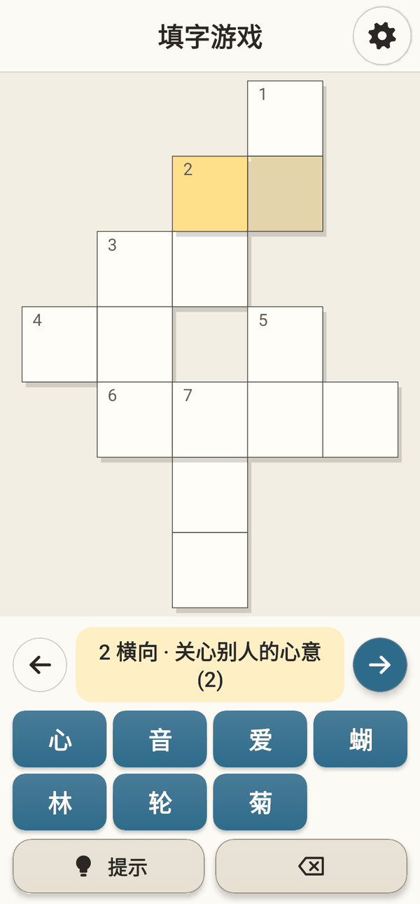

<div align="center">

# Mega Games

**十款经典游戏，装在一个小巧、注重隐私的安卓应用里——专为老年人设计。**

数独 · 纸牌接龙 · 巴西拉米（Buraco）· 双陆棋 · 麻将连连看 · 黑白棋 · 填字游戏 · 接水管 · 颜色连线 · 点点消除

🌐 [English](README.md) · [Português](README.pt-BR.md) · [Español](README.es.md) · [Français](README.fr.md) · **中文**

[](https://github.com/fershibli/game-mega-app/actions/workflows/ci.yml)


  

</div>

> 这个应用是为我母亲做的，她很喜欢这些游戏。它对所有人永久免费：
> 没有广告，不用注册，没有内购，不联网，也不收集任何数据。

## 目录

1. [亮点](#亮点)
2. [游戏介绍](#游戏介绍)
3. [为老年人设计](#为老年人设计)
4. [安装](#安装)
5. [为什么可以信任它](#为什么可以信任它)
6. [截图](#截图)
7. [文档](#文档)
8. [从源代码构建](#从源代码构建)
9. [在 AI 帮助下完成](#在-ai-帮助下完成)
10. [许可证](#许可证)

## 亮点

- **10 款游戏**，每款都有 **简单 / 中等 / 困难** 三个难度。
- **题目即时生成**（数独、麻将、接水管、颜色连线、填字游戏……），永远不会重复——而且每一道生成的题目都**保证有解**。
- **真正的电脑对手**：专门为双陆棋、巴西拉米和黑白棋编写的策略。
- **所有游戏都支持双指缩放**，单手模式下还能用一根手指缩放。
- **自动保存**：应用意外关闭后，再次打开会询问是否从中断的地方继续。
- **5 种语言**：英语、巴西葡萄牙语、西班牙语、法语和简体中文——界面和填字游戏的词库都已翻译。
- **小巧轻便**：约 **1.3 MB**，原生 Kotlin + Jetpack Compose，没有游戏引擎，也没有图片——所有画面都由代码绘制。

## 游戏介绍

| | 游戏 | 简介 | 难度如何变化 |
|---|---|---|---|
|  | **数独** | 经典 9×9 数字谜题，可做笔记、提示和撤销 | 初始数字 40 → 32 → 26；简单和中等难度会用红色标出错误 |
|  | **纸牌接龙** | 克朗代克接龙；点一下牌，它会自动移到最合适的位置 | 每次翻 1 张 → 翻 3 张 → 翻 3 张且只能翻 3 轮 |
|  | **巴西拉米** | 和电脑对战的巴西拉米牌（两副牌、2 是百搭、备用牌、卡纳斯塔） | 电脑更聪明：适时拿弃牌堆，保护百搭牌，避免给你送牌 |
|  | **双陆棋** | 完整规则（中间栏、打子、移出、全胜） | 从“随意”的电脑到能多看一步骰子的电脑（期望极大极小搜索） |
|  | **麻将连连看** | 立体麻将牌；被挡住的牌会变暗 | 48 → 96 → 144 张牌（经典“乌龟”阵） |
|  | **黑白棋** | 和电脑下奥赛罗棋；会显示可以落子的位置 | Alpha-Beta 搜索深度 1 → 3 → 6（残局完美） |
|  | **填字游戏** | 每次都是新的填字题，使用你的语言 | 字库选字 → 完整键盘；困难模式不提示错误 |
|  | **接水管** | 旋转管子，直到水流到每一节 | 5×5 → 7×7 → 9×9 |
|  | **颜色连线** | 把同色的点连起来，线不能交叉 | 5×5/4 色 → 7×7/6 色 → 9×9/8 色；中等和困难要铺满棋盘 |
|  | **点点消除** | 连接同色圆点；连成方框可消除整种颜色 | 棋盘更大、颜色更多、步数更少 |

完整规则和技巧：**[用户指南](docs/zh-CN/user-guide.md)**。

## 为老年人设计

- **操作非常简单**：选游戏（只看图片，不用读字）→ 在滚轮上选难度 → 开始玩。齿轮（⚙）永远在同一个角落。
- **按钮在拇指够得着的地方**：几乎所有操作按钮都在屏幕下半部分。**左手模式**会把它们左右对调。
- **单手模式**：齿轮变成悬浮小球，会缩到屏幕边缘；缩放可以用**双击**或**按住旋转**。
- **文字大小和棋子/按钮大小可调**（80% 到 160%）。
- **三种颜色模式，每种都有自己的深色版本**：普通（中等对比度）、高对比度（粗轮廓）、色盲友好（Okabe–Ito 配色、彩色棋子上画有形状、四色扑克牌）。
- 触控区域大（56 dp），字体大，有提示和无限撤销，没有任何计时器。

更多内容：**[用户指南中的无障碍部分](docs/zh-CN/user-guide.md#无障碍)**。

## 安装

1. 在安卓手机上打开 **[Releases](https://github.com/fershibli/game-mega-app/releases)**，下载最新的 `MegaGames-vX.Y.Z.apk`。
2. 打开这个文件。如果系统提示，请允许浏览器或文件管理器“安装未知应用”。
3. 可选：把文件的 SHA-256 与同一版本中的 `SHA256SUMS.txt` 对比。

需要 Android 6.0 或更高版本。详细步骤：[用户指南 → 安装](docs/zh-CN/user-guide.md#安装)。

## 为什么可以信任它

| 说法 | 你自己如何验证 |
|---|---|
| 不联网，不追踪 | 清单文件**没有声明任何权限**（[AndroidManifest.xml](app/src/main/AndroidManifest.xml)）；没有 `INTERNET` 权限，安卓会阻止一切网络连接。 |
| 没有隐藏代码 | 100% 开源；只使用官方的 AndroidX/Kotlin 库（[libs.versions.toml](gradle/libs.versions.toml)）。没有任何广告或统计 SDK。 |
| CI 构建的就是你安装的 | 每次推送都会在 GitHub Actions 上构建、测试和检查；APK 附带 SHA-256 校验和发布。已关闭 Google 的“依赖信息”区块，APK 的全部内容都可检查。 |
| 运行可靠 | 每次构建运行 50 个自动化测试：游戏规则、题目生成（每道题都有解）、AI、翻译、自动保存以及界面流程（缩放、单手模式、导航）。Lint 把警告当作错误处理。 |
| 构建工具安全 | Gradle wrapper 的校验和已固定，并在 CI 中验证；Dependabot 负责保持依赖更新。 |

详情：**[信任、隐私与安全](docs/zh-CN/trust.md)** · [SECURITY.md](SECURITY.md)

## 截图

| 主界面（深色） | 高对比度 | 色盲友好 + 深色 | 单手模式 |
|---|---|---|---|
|  |  |  |  |

| 选择难度 | 设置 | 继续吗？ | 中文填字游戏 |
|---|---|---|---|
|  |  |  |  |

所有截图都由真实代码自动生成（见[构建文档](docs/zh-CN/building.md#截图)）。

## 文档

| 语言 | 用户指南 | 信任与隐私 | 技术设计 | 构建与贡献 |
|---|---|---|---|---|
| English | [user-guide](docs/en/user-guide.md) | [trust](docs/en/trust.md) | [technical](docs/en/technical.md) | [building](docs/en/building.md) |
| Português | [guia](docs/pt-BR/user-guide.md) | [confiança](docs/pt-BR/trust.md) | [técnico](docs/pt-BR/technical.md) | [compilar](docs/pt-BR/building.md) |
| Español | [guía](docs/es/user-guide.md) | [confianza](docs/es/trust.md) | [técnico](docs/es/technical.md) | [compilar](docs/es/building.md) |
| Français | [guide](docs/fr/user-guide.md) | [confiance](docs/fr/trust.md) | [technique](docs/fr/technical.md) | [compiler](docs/fr/building.md) |
| 中文 | [用户指南](docs/zh-CN/user-guide.md) | [信任与隐私](docs/zh-CN/trust.md) | [技术设计](docs/zh-CN/technical.md) | [构建与贡献](docs/zh-CN/building.md) |

完整索引：[docs/README.md](docs/README.md)。

## 从源代码构建

```bash
git clone https://github.com/fershibli/game-mega-app.git
cd game-mega-app
./gradlew testDebugUnitTest lintDebug assembleDebug
# APK：app/build/outputs/apk/debug/app-debug.apk
```

需要 JDK 17+ 和 Android SDK（API 37）。见 [docs/zh-CN/building.md](docs/zh-CN/building.md)。

## 在 AI 帮助下完成

本仓库中的一切——代码、美术（每张牌、每块麻将、每个棋盘和图标都由代码绘制）以及这五种语言的文档——都是在 **Anthropic** 公司的 AI 助手 **Claude** 的帮助下，在维护者的指导下完成的。设计决策写在 [docs/zh-CN/technical.md](docs/zh-CN/technical.md) 中；完整的测试套件让任何人都不必盲目相信这些代码。

## 许可证

[MIT](LICENSE)——可以自由使用、复制、修改和分享。
